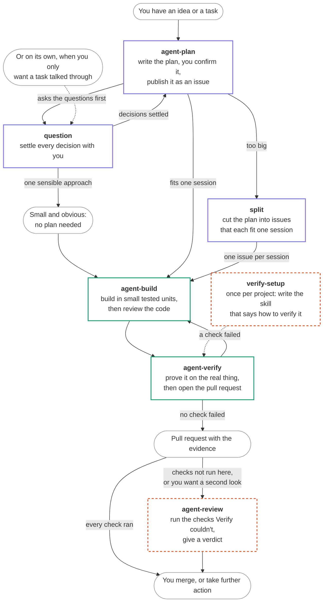

# How the skills fit together

Seven skills, one per stage of a change. Each is started by hand with a slash command, and each can lead into the next.

Boxes are skills. Rounded shapes are you, or something handed to you.

- Purple outline: the agent works with you.
- Green outline: the agent works alone.
- Dashed orange outline: used only sometimes.

| Skill | Starts from | What it does | Hands on to |
| --- | --- | --- | --- |
| `agent-plan` | An idea or a task. This is the usual way in | Runs `question` first, then writes the plan with its acceptance checks, asks you to confirm, and publishes it as an issue | `agent-build`, or `split` when the work won't fit one session |
| `question` | `agent-plan`, or you, when you only want a task talked through | Restates the goal, traces the code, and asks you in rounds until nothing is assumed | Back to `agent-plan`, or straight to building when the change is small and obvious |
| `split` | A confirmed plan | Cuts it into thin slices, one issue each, with what each waits on | `agent-build`, once per issue |
| `agent-build` | A plan or an issue | Builds one tested unit at a time, reads the whole diff, runs the project's checks, and has the code reviewed | `agent-verify` |
| `agent-verify` | A built change | Runs each acceptance check on the real thing, and goes back to building when one fails | A pull request with the evidence, the checks it couldn't run, and the risk |
| `agent-review` | An open pull request, in a session that didn't build it | Runs the checks Verify couldn't, looks past the list, and fixes a small slip or sends a wrong approach back | A verdict. You merge |
| `verify-setup` | A project with no written way to verify it | Writes a `verify-<project>` skill and a feature map, then proves them once | Every later `agent-verify` in that project |

You stay in the loop through `question`, `agent-plan` and `split`. From `agent-build` to the pull request the agent works alone, and stops only when blocked or for a decision that can't be undone. `agent-review` is optional: use it when checks couldn't be run, or when you want a second look.

Each skill's folder has a `SOURCES.md` that says where every idea in it came from.
